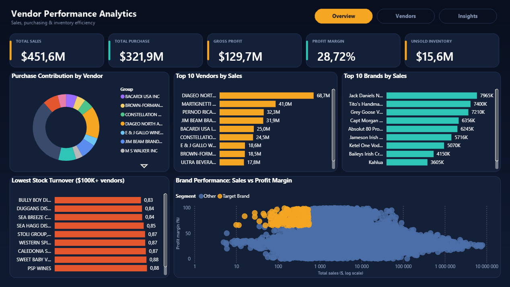
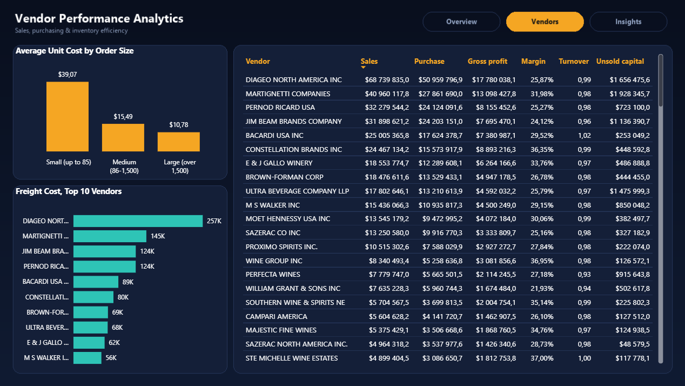
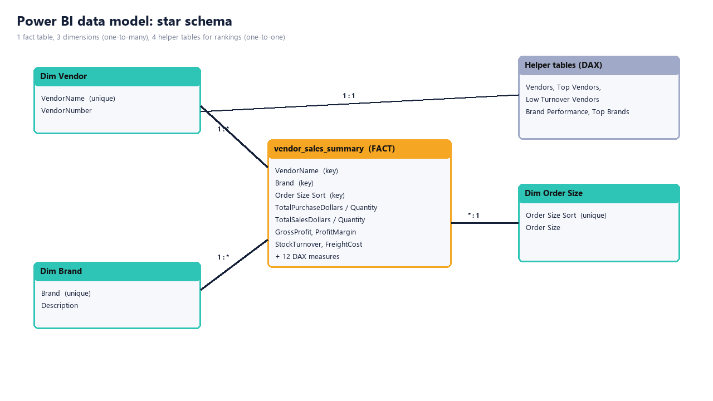
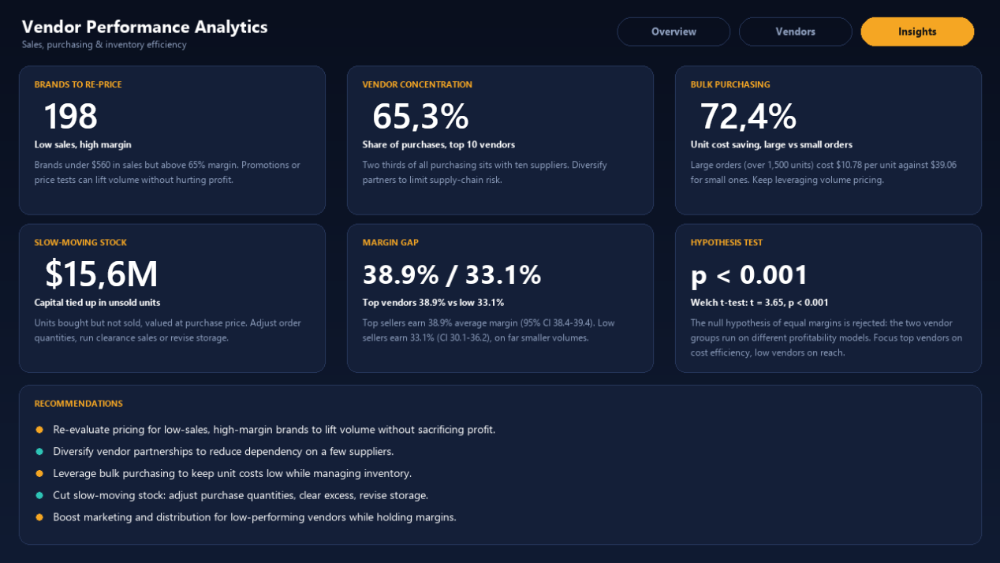

# Vendor Performance Analytics

Quels fournisseurs rapportent, lesquels coûtent, et où l'argent dort ? Analyse de bout en bout des achats, ventes et stocks d'un distributeur : **SQL (SQLite)** pour assembler 15,5 millions de lignes, **Python** pour automatiser et analyser, **Power BI** pour présenter.



## Architecture

```
6 fichiers CSV bruts ──► SQLite (inventory.db) ──► table de synthèse ──► analyse Python ──► dashboard Power BI
   ~15,5 M de lignes      ingestion par blocs       1 ligne par           notebook + test      3 pages, schéma
                                                    fournisseur/marque    statistique          en étoile
```

| Étape | Outil | Rôle |
|---|---|---|
| 1. Ingestion des CSV dans une base | Python + SQLite | chargement par blocs de 500 000 lignes |
| 2. Table de synthèse | SQL | CTE et jointures : une ligne par fournisseur et marque |
| 3. Requêtes métier | SQL | concentration, achats en gros, stock invendu, marques à re-pricer |
| 4. Analyse exploratoire et statistique | Python (notebook) | graphiques et test d'hypothèse |
| 5. Modèle et dashboard | Power BI | schéma en étoile, 3 pages |

## Résultats

| Question | Réponse |
|---|---|
| Quelles marques re-pricer ? | **198 marques** vendent peu mais avec une marge supérieure à 65 % |
| Dépendance aux fournisseurs ? | **10 fournisseurs sur 128 = 65,3 %** des achats |
| Acheter en gros, ça paie ? | **10,78 $** la bouteille en grosse commande contre **39,07 $** en petite (72 % moins cher) |
| Stock immobilisé ? | **15,6 M$** dans des unités achetées mais non vendues |
| Les meilleurs fournisseurs ont-ils plus de marge ? | **38,9 %** contre **33,1 %** (test de Welch, p < 0,001) |

Chiffres globaux : ventes 451,6 M$, achats 321,9 M$, bénéfice brut 129,7 M$, marge 28,7 %.



## SQL

Cinq requêtes SQLite répondent aux questions métier :

- **01** : trois CTE (frais de transport, achats, ventes) assemblées par `LEFT JOIN`, pour ne perdre aucune marque achetée mais jamais vendue.
- **02** : fonctions de fenêtre (`SUM() OVER`, `ROW_NUMBER`) pour la part et le cumul des 10 premiers fournisseurs.
- **03** : `CASE WHEN` pour ranger les commandes en petite, moyenne et grosse, puis coût moyen par bouteille.
- **04** : `SUM(MAX(0, achetées - vendues) * prix)` pour valoriser le stock invendu.
- **05** : `PERCENT_RANK` pour isoler les 15 % de marques les moins vendues et les 15 % les plus marginales.


## Modèle Power BI

Schéma en étoile : la table de faits `vendor_sales_summary` est reliée à `Dim Vendor`, `Dim Brand` et `Dim Order Size` (relations un-à-plusieurs). Les tables de classement (top 10, rotation la plus faible) sont reliées en un-à-un aux dimensions, donc un clic sur une barre filtre tout le rapport. 15 mesures DAX : ventes, achats, marge, capital immobilisé, coût unitaire moyen, part des 10 premiers, etc.





## Sources

Ce dépôt est une **vitrine** : il présente le projet et ses résultats. Les sources (projet Power BI, requêtes, scripts, notebook, données) ne sont pas publiées. Pour en discuter, me contacter via mon profil GitHub.

## Crédits

Projet inspiré d'un tutoriel vidéo « Vendor Performance Data Analytics End-To-End » (SQL, Python, Power BI). Les scripts d'ingestion et de synthèse partent de ceux du tutoriel ; j'ai ajouté le chargement par blocs, les requêtes SQL 02 à 05, le notebook exécuté, le modèle en étoile et le dashboard. Le projet a été construit avec l'aide de Claude.
